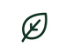
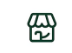
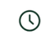
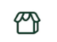

<p align="center">

  

</p>

<p align="center">

  <strong>Una segunda oportunidad para cada alimento.</strong>

</p>

<p align="center">


-073425?style=for-the-badge&logo=android&logoColor=white)


</p>

<p align="center">
  Proyecto FAT 2026 · Escuela El Obraje · 7.º C · Especialidad Informática · Alta Gracia, Córdoba
</p>

---

## Probá Lüp

| | |
|---|---|
| 🌐 **Página web** | https://www.lupalimentos.com |
| 📱 **App para Android** | Entrá a la web desde el celular y tocá **"Descargar la app"**, o usá [este link](https://drive.google.com/file/d/1A3HXX4eX8W-bLU6BY6kA4ye7r4BwRsHT/view?usp=sharing) |
| 📖 **Manual de usuario** | [`doc/Pdf/Manuales - de empresa/Manual de usuario.pdf`](doc/Pdf/Manuales%20-%20de%20empresa/Manual%20de%20usuario.pdf) |
| 📸 **Instagram** | [@lupalimentos](https://www.instagram.com/lupalimentos) |

---

##  ¿Qué es Lüp?

Lüp es una plataforma (página web + app para celular) que conecta **comercios**, **consumidores** y **fundaciones** para reducir el desperdicio alimentario mediante la venta con descuento y la donación de excedentes.

Nuestro objetivo es transformar alimentos próximos a vencer en oportunidades, generando un impacto **ambiental**, **social** y **económico**.

## ¿Qué problema resuelve?

En Argentina se pierden o desperdician cerca de **16 millones de toneladas de alimentos por año** (Ministerio de Agroindustria / FAO).
Muchos son productos todavía aptos para comer que los comercios tiran porque están por vencer o les sobró stock.
Eso significa plata perdida para el comercio, recursos desperdiciados para el ambiente y comida que no llega a quien la necesita.
En Alta Gracia no había ninguna herramienta que resolviera esto.

## ¿Cómo lo resuelve?

1. **El comercio publica** lo que está por vencer, con descuento (precio original, precio Lüp, cantidad y fecha).
2. **El consumidor elige** exactamente qué productos quiere (no una "caja sorpresa"), los **reserva** y los retira en el local con un código.
3. **Lo que no se vende** y sigue siendo apto se puede **donar** a fundaciones y comedores, que lo piden desde Lüp.

Prioridad del alimento: **venta → donación → descarte** (solo si ya no es apto).

## Público objetivo

| Quién | Por qué lo necesita |
|---|---|
| **Comercios de alimentos** (panaderías, rotiserías, verdulerías, almacenes) | Recuperan parte del costo de lo que hoy tiran y suman clientes. |
| **Consumidores** | Compran comida en buen estado más barata, cerca de su casa. |
| **Fundaciones y comedores** | Reciben donaciones de alimentos de forma ordenada. |
| **Municipios e instituciones** (a futuro) | Miden y reducen el desperdicio de la ciudad. |

---

##  Objetivos

- Reducir el desperdicio alimentario.
- Promover la economía circular.
- Disminuir pérdidas económicas en comercios.
- Facilitar el acceso a alimentos a menor costo.
- Impulsar donaciones responsables.
- Incorporar Inteligencia Artificial para optimizar la gestión de excedentes.

---

##  Funcionalidades

### Comercios

- Publicación de excedentes con una foto: la IA completa los datos.
- Descuentos con precio original y precio Lüp.
- Gestión de stock, "Publicar de nuevo" y historial.
- Confirmación de retiros con código o QR.
- Impacto del mes: plata recuperada y comidas salvadas.

### Consumidores

- Ofertas cercanas con mapa, buscador y filtros.
- Reserva con código de retiro y QR (se paga en el local).
- Historial, opiniones y favoritos.
- **Puntos Lüp**: 1 punto cada $2.000, que se canjean por merch sustentable.

### Organizaciones

- Donaciones disponibles de comercios cercanos.
- Pedidos de donación y seguimiento (enviado, aprobado, retirado).

### Inteligencia Artificial

- **Completar con IA**: reconoce el producto en una foto y sugiere nombre, categoría, descripción, precio y vencimiento.
- **Chat de ayuda con IA ("Lü")**: responde dudas y problemas de los usuarios en la web y en la app.

---

##  Impacto

| Ambiental | Social | Económico |
|-----------|--------|-----------|
| 🌿 Menos desperdicio | 🤝 Mayor acceso a alimentos | 💰 Menores pérdidas |
| ♻️ Economía circular | ❤️ Apoyo a organizaciones | 📦 Mejor aprovechamiento |
| 🌎 Reducción de residuos | 👥 Consumo responsable | 📈 Optimización del stock |

---

##  Tecnologías

| Parte | Tecnologías |
|---|---|
| **Backend** | Python 3 · Django 6.1 · Django REST Framework (API con token para la app) |
| **Página web** | HTML · CSS · JavaScript · Bootstrap · modo oscuro · español / inglés |
| **App para celular** | React Native 0.88 · Expo SDK 58 · React Navigation · Expo Notifications + Firebase (push) · react-native-maps · EAS Build (APK) |
| **Base de datos** | PostgreSQL en Render (producción) · SQLite (desarrollo) |
| **Inteligencia Artificial** | Claude (API de Anthropic) para el chat de ayuda "Lü" y para completar productos con una foto |
| **Publicación** | Render (web, API y base de datos) · dominio www.lupalimentos.com con Cloudflare |
| **Servicios** | Gmail (avisos por email) · Google Maps · Expo Application Services (EAS) |
| **Organización** | Git y GitHub (ramas por integrante + Pull Requests) · GitHub Projects (Kanban) |
| **Diseño** | Mockup propio · tipografías DM Sans y Poppins · paleta verde (#073425, #71A24D, #B6D1A1) |

---

##  Estructura

```text
LUP/
├── .gitignore
├── README.md
├── requirements.txt
├── manage.py
│
├── scr/                          <-- 🌐 CÓDIGO FUENTE DE LA PÁGINA WEB
│   ├── lup/                      <-- Configuración principal de Django (settings, urls)
│   ├── bd_lup/                   <-- Aplicaciones internas
│   │   ├── users/                <-- Usuario personalizado, organizaciones, login y registro
│   │   ├── stores/               <-- Perfil de comercio (Tienda)
│   │   ├── products/             <-- Productos, reservas, donaciones, API, IA de fotos y paneles
│   │   ├── puntos/               <-- Puntos Lüp y canje de merch
│   │   └── soporte/              <-- Chat de ayuda "Lü"
│   ├── descargas/                <-- APK de Android que se descarga desde la web
│   ├── templates/                <-- Plantillas HTML
│   └── static/                   <-- CSS, JS e imágenes de la web
│
├── app/                          <-- 📱 APP PARA CELULAR (React Native + Expo)
│   ├── App.js                    <-- Punto de entrada (fuentes, tema, navegación)
│   ├── app.json                  <-- Configuración de Expo / EAS (nombre, íconos, permisos)
│   ├── assets/                   <-- Logo, íconos, video de la intro
│   └── src/
│       ├── api/                  <-- Cliente de la API de Django
│       ├── componentes/          <-- Botones, campos, tarjetas, íconos
│       ├── contexto/             <-- Sesión, carrito, favoritos, tema claro/oscuro
│       ├── navegacion/           <-- Pantallas y pestañas según el tipo de cuenta
│       ├── pantallas/            <-- Inicio, catálogo, mapa, carrito, reservas, perfil…
│       │   ├── comercio/         <-- Mis productos, publicar, confirmar retiro, solicitudes
│       │   └── organizacion/     <-- Donaciones disponibles y mis solicitudes
│       └── servicios/            <-- Notificaciones push y recordatorios de retiro
│
├── doc/                          <-- 📄 DOCUMENTACIÓN DEL PROYECTO (en Word y en PDF)
│   ├── Pdf/ y Word/
│   │   ├── Comercio/             <-- FODA, costos, break even, mercado, estrategias de adquisición
│   │   ├── Diseño/               <-- Mockup y guía de merch
│   │   ├── Legales/              <-- Pasos legales y propiedad intelectual
│   │   └── Manuales - de empresa/ <-- Manual de usuario, lluvia de ideas, propuesta de valor, testing
│   └── Excel/                    <-- Planilla de testing cruzado
│
├── jpg/                          <-- 🖼️ IMÁGENES DE DOCUMENTACIÓN
│   ├── diseño/                   <-- Logo, sublogo, merch, stickers y logos adicionales
│   ├── doc_assets/               <-- Íconos usados en este README
│   ├── comercio/                 <-- Gráfico FODA, modelo de negocio
│   └── manuales - de empresa/    <-- Balance del MVP y piezas publicitarias
│
└── media/                        <-- Fotos subidas desde la web (se crea sola, no se sube a git)
```

---

##  Estado Técnico Actual

Plataforma web funcional en Django con tres tipos de cuenta:

| Rol | Puede |
|-----|-------|
| **Consumidor** | Buscar y filtrar ofertas, reservar con código de retiro (de a una o varias juntas con el carrito), cancelar reservas, ver historial y ahorro. |
| **Comercio** | Publicar / editar / eliminar excedentes con vista previa en vivo, confirmar retiros por código, aprobar donaciones, ver estadísticas. |
| **Organización** | Solicitar productos marcados como donables y seguir el estado de sus solicitudes. |

- **Apps:** `users` (usuario personalizado `Usuario` + perfil `Organizacion`), `stores` (perfil `Tienda` del comercio) y `products` (`Producto`, `Reserva`, `SolicitudDonacion`).
- **Login** con usuario o email y selector de tipo de cuenta; **registro** guiado en 2 pasos según el rol.
- **API REST** en `/api/...` (con token) que usa la app: ofertas, comercios, opiniones, reservas, donaciones y notificaciones.
- **Opiniones**: el consumidor califica al comercio y al producto después de retirar; el comercio puede responder.
- **Chat de ayuda "Lü"** con Inteligencia Artificial, avisos por email y mapa de comercios cercanos.
- **Tests** automáticos de todos los flujos (`python manage.py test scr`).

### App para celular

- Intro animada, inicio de sesión por tipo de cuenta y bienvenida personalizada.
- **Consumidor:** inicio con ofertas, buscador, catálogo, mapa, favoritos, carrito con varias unidades, reservas con código de retiro, opiniones e impacto (cuánto ahorró y cuánta comida salvó).
- **Comercio:** publicar y editar productos, confirmar retiros con el código y responder pedidos de donación.
- **Fundación:** ver donaciones disponibles, pedirlas y seguir sus solicitudes.
- **Notificaciones push** (Expo + Firebase) y recordatorio 30 minutos antes del horario de retiro.
- **Completar con IA**: el comercio saca una foto y la IA completa el producto.
- **Puntos Lüp** con fotos del merch y canje desde la app.
- **Chat de ayuda "Lü"**, modo claro y oscuro, español e inglés.

### Funcionalidades clave

- [x] Registro e inicio de sesión con 3 tipos de cuenta
- [x] Publicación de productos con descuento y fecha de vencimiento
- [x] Reservas con código de retiro
- [x] Donaciones a fundaciones
- [x] Mapa y comercios cercanos
- [x] Opiniones y calificaciones
- [x] Avisos por email y notificaciones push
- [x] Chat de ayuda con IA
- [x] Página bilingüe (español / inglés)
- [x] Carga de productos con una foto (IA)
- [x] Puntos Lüp con canje de merch
- [x] App en español e inglés, modo claro y oscuro
- [x] Página publicada en www.lupalimentos.com
- [x] APK de Android descargable desde la web
- [ ] Publicación en Google Play
- [ ] Pago online con Mercado Pago

---

##  Cómo ejecutarlo

### 1. Página web y API (carpeta `LUP`)

```bash
git clone https://github.com/Code7C26/LUP.git
cd LUP
python -m venv venv
source venv/bin/activate          # Windows: venv\Scripts\activate
pip install -r requirements.txt
python manage.py migrate
python manage.py createsuperuser  # opcional: acceso a /admin
python manage.py runserver
```

Abrí http://127.0.0.1:8000.

### 2. App para celular (carpeta `LUP/app`)

Necesitás Node.js y la app **Expo Go** en el celular (o un emulador de Android).

```bash
cd app
npm install
npx expo start
```

Escaneá el código QR con Expo Go. El celular y la compu tienen que estar en la **misma red Wi-Fi**,
y Django tiene que correr escuchando en la red:

```bash
python manage.py runserver 0.0.0.0:8000
```

La app busca el servidor sola en la misma compu que corre Expo. Para usar otro servidor, creá `app/.env` con
`EXPO_PUBLIC_URL_SERVIDOR=http://IP-DE-TU-COMPU:8000`.

### Datos de muestra (solo para desarrollo)

`python manage.py cargar_demo` crea comercios, ofertas, reservas y opiniones **inventadas** para probar
(usuarios `panaderia_sol`, `consumidor_demo` y `comedor_demo`, clave `LupDemo2026!`). No funciona con `DEBUG=0`.

**Antes de presentar o publicar la página**, borrá todo lo de muestra (solo toca las cuentas `@lup.demo`):

```bash
python manage.py limpiar_demo
```

---

##  Gmail y Google Maps

La configuración va en un archivo **`.env`** en la raíz del proyecto (nunca se sube a GitHub).
Copiá el ejemplo y completalo:

```bash
cp .env.ejemplo .env
```

### Avisos por Gmail para todos los usuarios

| Quién | Recibe un email cuando… |
|---|---|
| **Todos** | crean su cuenta (bienvenida) |
| **Consumidor** | reserva (con el código de retiro y "Cómo llegar"), cancela, es el último día para retirar, el comercio confirma el retiro ("¿Cómo te fue?") y el comercio responde su opinión |
| **Comercio** | alguien reserva o cancela, un producto se queda sin stock, una organización pide una donación y un cliente deja una opinión |
| **Organización** | le aprueban o rechazan un pedido de donación y se publica una donación nueva |

Funcionan igual desde la web y desde la app. Cada persona puede apagarlos en *Mis datos → Avisos por email*
o con el link **"Dejar de recibir avisos"** que va al pie de cada email.

El recordatorio del último día se manda **solo** en la página publicada: una vez por día, con la primera
visita después de las 9 (`RECORDATORIOS_HORA`). No hace falta ninguna tarea programada.
En la compu se puede probar a mano:

```bash
python manage.py enviar_recordatorios
```

1. Usá una cuenta de Gmail para el proyecto (ej: `lup.avisos@gmail.com`) con la **verificación en 2 pasos** activada.
2. Entrá a https://myaccount.google.com/apppasswords y creá una **contraseña de aplicación** (16 letras).
3. En el `.env`:
   ```
   GMAIL_USUARIO=lup.avisos@gmail.com
   GMAIL_CLAVE_APP=abcdefghijklmnop
   ```
4. Reiniciá el servidor.

Sin esos datos los emails no se envían: se muestran en la consola donde corre `runserver` (sirve para probar).

### Ubicación del dispositivo y Google Maps

- **Al entrar** (inicio, ofertas y comercios) la página le pregunta al cliente si quiere usar su ubicación.
  Si acepta, se muestran solo los comercios y ofertas **cercanos** (radio de 2, 5, 10 o 25 km, o cualquier distancia).
  Si dice "Ahora no", no se le vuelve a preguntar por 7 días; siempre puede tocar **"Cerca mío"**.
- **Comercios** (`/comercios/`): lista de comercios ordenados por cercanía, con distancia, ofertas y opiniones.
- **Producto y página del comercio:** mapa de Google Maps, distancia ("A 1,2 km de vos") y botón **Cómo llegar**.
- **Mis datos (comercio):** botón *"Usar la ubicación de este dispositivo"* para marcar dónde está el local.

Funciona **sin clave**. Opcionalmente, con una clave de Google Cloud (activando *Maps Embed API* y *Geocoding API*)
se usan los mapas oficiales y cada comercio se ubica solo a partir de su dirección:

```
GOOGLE_MAPS_API_KEY=tu_clave
```

> Los navegadores solo comparten la ubicación en `localhost` o en sitios con **https**.

Con la clave, además, quien no quiera compartir su ubicación puede **escribir su dirección o barrio**.

---

##  Chat de ayuda con IA

En todas las páginas hay un botón **Ayuda** (abajo a la derecha) que abre un chat con **Lü**, el asistente de Lüp.
Conoce cómo funciona la página para cada tipo de cuenta y, si la persona inició sesión, sus reservas pendientes
(o las ofertas y retiros de su comercio) para dar respuestas concretas. Responde en español o inglés según la página.

- Funciona con **Claude** (API de Anthropic). Agregá al `.env`:

```
ANTHROPIC_API_KEY=tu_clave
SOPORTE_EMAIL=email_del_equipo@gmail.com
```

- Sin clave, el chat igual funciona con **respuestas automáticas** (preguntas frecuentes).
- **Hablar con una persona**: manda la conversación por email a `SOPORTE_EMAIL` (o a `GMAIL_USUARIO`) para responderle al usuario.
- Todas las charlas quedan en `/admin` → *Conversaciones de soporte* (se pueden marcar como resueltas).
- Límites: 800 caracteres por mensaje y 30 mensajes por hora por persona. El modelo se cambia con `SOPORTE_MODELO` (por defecto `claude-haiku-5-5`).

---

##  Publicar la página (Render)

La página está lista para publicarse en [Render](https://render.com) con el archivo `render.yaml`
(un *Blueprint*: Render lo lee y crea todo solo). Cada cambio que llega a `main` se publica automáticamente.

**Qué se crea** (planes pagos; el gratuito no manda emails, se duerme y borra la base a los 30 días):

| Parte | Plan en Render | Para qué |
|---|---|---|
| Página web `lup` | Starter (0.5 CPU, 512 MB) | Django con gunicorn; CSS y JS con WhiteNoise |
| Base de datos `lup-db` | PostgreSQL Basic 256 MB | Usuarios, comercios, ofertas, reservas |
| Disco `fotos` | 1 GB | Fotos de productos, logos y fotos de perfil |

Costo aproximado: unos US$13 por mes (verificar en render.com/pricing). Se puede dar de baja cuando quieran.

### Paso a paso

1. Creá una cuenta en Render con GitHub y dale acceso al repositorio `Code7C26/LUP`.
2. **New → Blueprint**, elegí el repositorio y la rama `main`. Render muestra lo que va a crear.
3. Completá las claves que pide (quedan solo en Render, nunca en GitHub):
   `GMAIL_USUARIO`, `GMAIL_CLAVE_APP`, y si las tienen, `ANTHROPIC_API_KEY` y `GOOGLE_MAPS_API_KEY`
   (las que no tengan, déjenlas vacías).
4. **Apply**. La primera vez tarda unos minutos: instala todo (`build.sh`), crea las tablas (`migrate`)
   y abre la página en `https://lup-xxxx.onrender.com`.
5. Creá la cuenta de administrador: en el servicio `lup` → **Shell** →
   `python manage.py createsuperuser`.
6. Cargá las cuentas y ofertas reales (la base publicada empieza vacía; lo de la compu no se copia).

### Dominio propio

1. Comprá el dominio (ej. `lupalimentos.com`).
2. En Render: servicio `lup` → **Settings → Custom Domains** → agregá `lupalimentos.com` y `www.lupalimentos.com`.
   La dirección principal es `www.lupalimentos.com`: la versión sin www redirige ahí.
   Render muestra los registros DNS que hay que cargar donde compraste el dominio. El https es automático.
3. En **Environment** agregá y guardá (la página se reinicia sola):
   ```
   DJANGO_ALLOWED_HOSTS=lupalimentos.com,www.lupalimentos.com
   SITIO_URL=https://www.lupalimentos.com
   ```
   `SITIO_URL` es la dirección que va en los links de los emails.
4. En la app (`app/.env` y en las variables de EAS): `EXPO_PUBLIC_URL_SERVIDOR=https://www.lupalimentos.com`.
   Tiene que ir **con www**: la redirección desde la dirección sin www pierde el inicio de sesión de la app.

### Cómo se actualiza

- **Código**: se trabaja en cada rama, se pasa a `main` y Render publica solo (unos minutos).
  Las migraciones corren solas antes de publicar. Si algo falla, la versión anterior sigue online.
- **Contenido** (ofertas, comercios, opiniones): desde la misma página o `/admin`, al instante.
- **Errores**: pestaña **Logs** del servicio. `/salud/` responde `ok` si la página y la base funcionan.

### Variables de la página publicada

| Variable | Valor | Quién la pone |
|---|---|---|
| `DJANGO_DEBUG` | `0` | `render.yaml` |
| `DJANGO_SECRET_KEY` | clave aleatoria | Render la genera |
| `DATABASE_URL` | dirección de PostgreSQL | Render, desde `lup-db` |
| `MEDIA_ROOT` | `/var/data/media` (el disco) | `render.yaml` |
| `DJANGO_ALLOWED_HOSTS`, `SITIO_URL` | el dominio propio | ustedes (sin dominio no hacen falta) |
| `GMAIL_*`, `ANTHROPIC_API_KEY`, `GOOGLE_MAPS_API_KEY`, `SOPORTE_EMAIL` | claves | ustedes, en Environment |

En la compu no cambia nada: sin estas variables se usa SQLite y el modo desarrollo de siempre.

---

##  Idiomas (español / inglés)

Toda la página se puede ver en inglés con el botón **EN / ES** de la barra (al lado del modo oscuro).
La elección se guarda en el navegador. La API de la app móvil responde siempre en español.

Las traducciones están en `scr/locale/en/LC_MESSAGES/django.po`. Para cambiar un texto en inglés:

1. Editá el `msgstr` en `django.po` (y los textos del JavaScript en `scr/static/js/lup-en.js`).
2. Corré `python manage.py compilar_traducciones` (no hace falta instalar nada).
3. Reiniciá el servidor.

Si agregás textos nuevos en las plantillas, envolvelos con `` y sumalos al `.po`.
Lo que cargan los usuarios (nombres de productos, comercios, opiniones) no se traduce.

> Si tenías una base `db.sqlite3` de una versión anterior, borrala antes de `migrate`: los modelos se unificaron y las migraciones se regeneraron desde cero.
>
> Las fotos de productos ahora se guardan en `media/` (antes en `scr/jpg/`). Si tenés fotos viejas en tu compu, movelas de `scr/jpg/productos/` a `media/productos/`.

---

## Estado del proyecto

**Proyecto terminado y publicado.** La página está online en [www.lupalimentos.com](https://www.lupalimentos.com)
y la app para Android se descarga desde la web, con notificaciones push funcionando.

**Modelo de negocio:** alta gratuita para los comercios y comisión del 15 % por venta (20 % cuando se sume el pago online).

**Próximos pasos:** publicar la app en Google Play, sumar el pago online con Mercado Pago y probar Lüp con los primeros comercios y organizaciones de Alta Gracia.

---

## Equipo

| Integrante | Rol | Rama en GitHub |
|---|---|---|
| **Sofía Silva** | Project Manager · Desarrolladora Backend y Frontend (app) · Inteligencia Artificial · Branding y Comunicación Visual · QA · Datos e Impacto | `sofia` |
| **Josefina Caggiano** | Analista de Sistemas · Diseño UX/UI · Branding y Comunicación Visual · QA · Marketing y Relaciones Institucionales | `josefina` |
| **Trinidad Bossi Scaglia** | Desarrolladora de Base de Datos · Backend y Frontend (web) · Inteligencia Artificial · QA · Sostenibilidad y Legales | `trinidad` |

**Docente:** Prof. Tamara Piccinni · Escuela El Obraje, Alta Gracia

---

## Enlaces importantes

- Página web: https://www.lupalimentos.com
- Repositorio: https://github.com/Code7C26/LUP
- Instagram: [@lupalimentos](https://www.instagram.com/lupalimentos)
- Manual de usuario: [`doc/Pdf/Manuales - de empresa/Manual de usuario.pdf`](doc/Pdf/Manuales%20-%20de%20empresa/Manual%20de%20usuario.pdf)
- Mockup: [`doc/Pdf/Diseño/Mock up.pdf`](doc/Pdf/Dise%C3%B1o/Mock%20up.pdf)
- Documentación del negocio: [`doc/`](doc/)

---


<p align="center">

**Más valor. Menos desperdicio.**

</p>

