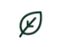
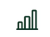
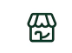
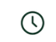
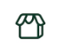
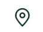
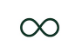

<p align="center">

  

</p>

<p align="center">

  <strong>Una segunda oportunidad para cada alimento.</strong>

</p>

<p align="center">


</p>

---

##  ¿Qué es Lüp?

Lüp es una plataforma inteligente que conecta comercios, consumidores y organizaciones para reducir el desperdicio alimentario mediante la venta con descuento y la gestión responsable de excedentes.

Nuestro objetivo es transformar alimentos próximos a vencer en oportunidades, generando un impacto **ambiental**, **social** y **económico**.

---

##  Objetivos

- Reducir el desperdicio alimentario.
- Promover la economía circular.
- Disminuir pérdidas económicas en comercios.
- Facilitar el acceso a alimentos a menor costo.
- Impulsar donaciones responsables.
- Incorporar Inteligencia Artificial para optimizar la gestión de excedentes.

---

##  Funcionalidades

### Comercios

- Publicación de excedentes.
- Descuentos inteligentes.
- Gestión de stock.
- Estadísticas de impacto.

### Consumidores

- Productos cercanos con descuento.
- Reserva desde la aplicación.
- Historial de compras.

### Organizaciones

- Gestión de donaciones.
- Solicitud de alimentos.

### Inteligencia Artificial

- Reconocimiento de productos.
- Carga automática de información.
- Recomendación de descuentos.
- Indicadores ambientales.

---

##  Impacto

| Ambiental | Social | Económico |
|-----------|--------|-----------|
| 🌿 Menos desperdicio | 🤝 Mayor acceso a alimentos | 💰 Menores pérdidas |
| ♻️ Economía circular | ❤️ Apoyo a organizaciones | 📦 Mejor aprovechamiento |
| 🌎 Reducción de residuos | 👥 Consumo responsable | 📈 Optimización del stock |

---

##  Tecnologías

- Python 3 + Django 6.1
- Django REST Framework (API para la app móvil)
- HTML
- CSS
- JavaScript
- Bootstrap
- SQLite (desarrollo) · PostgreSQL previsto para producción
- Git & GitHub
- Inteligencia Artificial

---

##  Estructura

```text
LUP/
├── .gitignore
├── README.md
├── requirements.txt
├── manage.py
│
├── scr/                          <-- 🌐 CÓDIGO FUENTE DE LA PÁGINA WEB
│   ├── lup/                      <-- Configuración principal de Django (settings, urls)
│   ├── bd_lup/                   <-- Aplicaciones internas
│   │   ├── users/                <-- Usuario personalizado, organizaciones, login y registro
│   │   ├── stores/               <-- Perfil de comercio (Tienda)
│   │   └── products/             <-- Productos, reservas, donaciones, API y paneles
│   ├── templates/                <-- Plantillas HTML
│   └── static/                   <-- CSS, JS e imágenes de la web
│
├── app/                          <-- 📱 APP MÓVIL (por ahora solo README con la API disponible)
│
├── doc/                          <-- 📄 DOCUMENTACIÓN DEL PROYECTO
│   ├── comercio/                 <-- Break-even, costos, FODA, investigación de mercado
│   ├── legales/                  <-- Pasos legales y propiedad intelectual
│   └── manuales - de empresa/    <-- Backlog, documentación inicial, mockup, propuesta de valor
│
├── jpg/                          <-- 🖼️ IMÁGENES DE DOCUMENTACIÓN
│   ├── diseño/                   <-- Logo y sublogo de Lüp
│   ├── doc_assets/               <-- Íconos usados en este README
│   ├── comercio/                 <-- Gráfico FODA, modelo de negocio
│   └── manuales - de empresa/    <-- Balance del MVP
│
└── media/                        <-- Fotos subidas desde la web (se crea sola, no se sube a git)
```

---

##  Estado Técnico Actual

Plataforma web funcional en Django con tres tipos de cuenta:

| Rol | Puede |
|-----|-------|
| **Consumidor** | Buscar y filtrar ofertas, reservar con código de retiro, cancelar reservas, ver historial y ahorro. |
| **Comercio** | Publicar / editar / eliminar excedentes con vista previa en vivo, confirmar retiros por código, aprobar donaciones, ver estadísticas. |
| **Organización** | Solicitar productos marcados como donables y seguir el estado de sus solicitudes. |

- **Apps:** `users` (usuario personalizado `Usuario` + perfil `Organizacion`), `stores` (perfil `Tienda` del comercio) y `products` (`Producto`, `Reserva`, `SolicitudDonacion`).
- **Login** con usuario o email y selector de tipo de cuenta; **registro** guiado en 2 pasos según el rol.
- **API REST** de solo lectura en `/api/productos/` para la futura app móvil.
- **Tests** automáticos de todos los flujos (`python manage.py test scr`).

---

##  Cómo ejecutarlo

```bash
python -m venv venv
source venv/bin/activate          # Windows: venv\Scripts\activate
pip install -r requirements.txt
python manage.py migrate
python manage.py createsuperuser  # opcional: acceso a /admin
python manage.py runserver
```

Abrí http://127.0.0.1:8000.

### Datos de muestra (solo para desarrollo)

`python manage.py cargar_demo` crea comercios, ofertas, reservas y opiniones **inventadas** para probar
(usuarios `panaderia_sol`, `consumidor_demo` y `comedor_demo`, clave `LupDemo2026!`). No funciona con `DEBUG=0`.

**Antes de presentar o publicar la página**, borrá todo lo de muestra (solo toca las cuentas `@lup.demo`):

```bash
python manage.py limpiar_demo
```

---

##  Gmail y Google Maps

La configuración va en un archivo **`.env`** en la raíz del proyecto (nunca se sube a GitHub).
Copiá el ejemplo y completalo:

```bash
cp .env.ejemplo .env
```

### Avisos por Gmail a los comercios

Cada comercio recibe un email cuando alguien **reserva**, **cancela** o **pide una donación** de sus productos
(desde la web o desde la app). Cada comercio puede apagarlos en *Mis datos → Avisos*.

1. Usá una cuenta de Gmail para el proyecto (ej: `lup.avisos@gmail.com`) con la **verificación en 2 pasos** activada.
2. Entrá a https://myaccount.google.com/apppasswords y creá una **contraseña de aplicación** (16 letras).
3. En el `.env`:
   ```
   GMAIL_USUARIO=lup.avisos@gmail.com
   GMAIL_CLAVE_APP=abcdefghijklmnop
   ```
4. Reiniciá el servidor.

Sin esos datos los emails no se envían: se muestran en la consola donde corre `runserver` (sirve para probar).

### Ubicación del dispositivo y Google Maps

- **Al entrar** (inicio, ofertas y comercios) la página le pregunta al cliente si quiere usar su ubicación.
  Si acepta, se muestran solo los comercios y ofertas **cercanos** (radio de 2, 5, 10 o 25 km, o cualquier distancia).
  Si dice "Ahora no", no se le vuelve a preguntar por 7 días; siempre puede tocar **"Cerca mío"**.
- **Comercios** (`/comercios/`): lista de comercios ordenados por cercanía, con distancia, ofertas y opiniones.
- **Producto y página del comercio:** mapa de Google Maps, distancia ("A 1,2 km de vos") y botón **Cómo llegar**.
- **Mis datos (comercio):** botón *"Usar la ubicación de este dispositivo"* para marcar dónde está el local.

Funciona **sin clave**. Opcionalmente, con una clave de Google Cloud (activando *Maps Embed API* y *Geocoding API*)
se usan los mapas oficiales y cada comercio se ubica solo a partir de su dirección:

```
GOOGLE_MAPS_API_KEY=tu_clave
```

> Los navegadores solo comparten la ubicación en `localhost` o en sitios con **https**.

Con la clave, además, quien no quiera compartir su ubicación puede **escribir su dirección o barrio**.

---

##  Idiomas (español / inglés)

Toda la página se puede ver en inglés con el botón **EN / ES** de la barra (al lado del modo oscuro).
La elección se guarda en el navegador. La API de la app móvil responde siempre en español.

Las traducciones están en `scr/locale/en/LC_MESSAGES/django.po`. Para cambiar un texto en inglés:

1. Editá el `msgstr` en `django.po` (y los textos del JavaScript en `scr/static/js/lup-en.js`).
2. Corré `python manage.py compilar_traducciones` (no hace falta instalar nada).
3. Reiniciá el servidor.

Si agregás textos nuevos en las plantillas, envolvelos con `` y sumalos al `.po`.
Lo que cargan los usuarios (nombres de productos, comercios, opiniones) no se traduce.

> Si tenías una base `db.sqlite3` de una versión anterior, borrala antes de `migrate`: los modelos se unificaron y las migraciones se regeneraron desde cero.
>
> Las fotos de productos ahora se guardan en `media/` (antes en `scr/jpg/`). Si tenés fotos viejas en tu compu, movelas de `scr/jpg/productos/` a `media/productos/`.

---


<p align="center">

**Más valor. Menos desperdicio.**

</p>

