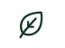
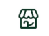
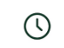
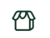
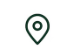

<p align="center">

  

</p>

<p align="center">

  <strong>Una segunda oportunidad para cada alimento.</strong>

</p>

<p align="center">


</p>

<p align="center">
  Proyecto FAT 2026 · 7.º año · Especialidad Informática · Alta Gracia, Córdoba
</p>

---

##  ¿Qué es Lüp?

Lüp es una plataforma (página web + app para celular) que conecta **comercios**, **consumidores** y **fundaciones** para reducir el desperdicio alimentario mediante la venta con descuento y la donación de excedentes.

Nuestro objetivo es transformar alimentos próximos a vencer en oportunidades, generando un impacto **ambiental**, **social** y **económico**.

## ¿Qué problema resuelve?

En Argentina se pierden o desperdician cerca de **16 millones de toneladas de alimentos por año** (Ministerio de Agroindustria / FAO).
Muchos son productos todavía aptos para comer que los comercios tiran porque están por vencer o les sobró stock.
Eso significa plata perdida para el comercio, recursos desperdiciados para el ambiente y comida que no llega a quien la necesita.
En Alta Gracia no había ninguna herramienta que resolviera esto.

## ¿Cómo lo resuelve?

1. **El comercio publica** lo que está por vencer, con descuento (precio original, precio Lüp, cantidad y fecha).
2. **El consumidor elige** exactamente qué productos quiere (no una "caja sorpresa"), los **reserva** y los retira en el local con un código.
3. **Lo que no se vende** y sigue siendo apto se puede **donar** a fundaciones y comedores, que lo piden desde Lüp.

Prioridad del alimento: **venta → donación → descarte** (solo si ya no es apto).

## Público objetivo

| Quién | Por qué lo necesita |
|---|---|
| **Comercios de alimentos** (panaderías, rotiserías, verdulerías, almacenes) | Recuperan parte del costo de lo que hoy tiran y suman clientes. |
| **Consumidores** | Compran comida en buen estado más barata, cerca de su casa. |
| **Fundaciones y comedores** | Reciben donaciones de alimentos de forma ordenada. |
| **Municipios e instituciones** (a futuro) | Miden y reducen el desperdicio de la ciudad. |

---

##  Objetivos

- Reducir el desperdicio alimentario.
- Promover la economía circular.
- Disminuir pérdidas económicas en comercios.
- Facilitar el acceso a alimentos a menor costo.
- Impulsar donaciones responsables.
- Incorporar Inteligencia Artificial para optimizar la gestión de excedentes.

---

##  Funcionalidades

### Comercios

- Publicación de excedentes.
- Descuentos inteligentes.
- Gestión de stock.
- Estadísticas de impacto.

### Consumidores

- Productos cercanos con descuento.
- Reserva desde la aplicación.
- Historial de compras.

### Organizaciones

- Gestión de donaciones.
- Solicitud de alimentos.

### Inteligencia Artificial

- Reconocimiento de productos.
- Carga automática de información.
- Recomendación de descuentos.
- Indicadores ambientales.
- **Chat de ayuda con IA ("Lü")**: responde dudas y problemas de los usuarios en toda la página.

---

##  Impacto

| Ambiental | Social | Económico |
|-----------|--------|-----------|
| 🌿 Menos desperdicio | 🤝 Mayor acceso a alimentos | 💰 Menores pérdidas |
| ♻️ Economía circular | ❤️ Apoyo a organizaciones | 📦 Mejor aprovechamiento |
| 🌎 Reducción de residuos | 👥 Consumo responsable | 📈 Optimización del stock |

---

##  Tecnologías

| Parte | Tecnologías |
|---|---|
| **Backend** | Python 3 · Django 6.1 · Django REST Framework (API con token para la app) |
| **Página web** | HTML · CSS · JavaScript · Bootstrap · modo oscuro · español / inglés |
| **App para celular** | React Native 0.88 · Expo SDK 58 · React Navigation · Expo Notifications (push) · react-native-maps |
| **Base de datos** | SQLite (desarrollo) · PostgreSQL previsto para producción |
| **Inteligencia Artificial** | Claude (API de Anthropic) para el chat de ayuda "Lü" |
| **Servicios** | Gmail (avisos por email) · Google Maps · Expo Application Services (EAS) |
| **Organización** | Git y GitHub (ramas por integrante + Pull Requests) · GitHub Projects (Kanban) |
| **Diseño** | Mockup propio · tipografías DM Sans y Poppins · paleta verde (#073425, #71A24D, #B6D1A1) |

---

##  Estructura

```text
LUP/
├── .gitignore
├── README.md
├── requirements.txt
├── manage.py
│
├── scr/                          <-- 🌐 CÓDIGO FUENTE DE LA PÁGINA WEB
│   ├── lup/                      <-- Configuración principal de Django (settings, urls)
│   ├── bd_lup/                   <-- Aplicaciones internas
│   │   ├── users/                <-- Usuario personalizado, organizaciones, login y registro
│   │   ├── stores/               <-- Perfil de comercio (Tienda)
│   │   └── products/             <-- Productos, reservas, donaciones, API y paneles
│   ├── templates/                <-- Plantillas HTML
│   └── static/                   <-- CSS, JS e imágenes de la web
│
├── app/                          <-- 📱 APP PARA CELULAR (React Native + Expo)
│   ├── App.js                    <-- Punto de entrada (fuentes, tema, navegación)
│   ├── app.json                  <-- Configuración de Expo / EAS (nombre, íconos, permisos)
│   ├── assets/                   <-- Logo, íconos, video de la intro
│   └── src/
│       ├── api/                  <-- Cliente de la API de Django
│       ├── componentes/          <-- Botones, campos, tarjetas, íconos
│       ├── contexto/             <-- Sesión, carrito, favoritos, tema claro/oscuro
│       ├── navegacion/           <-- Pantallas y pestañas según el tipo de cuenta
│       ├── pantallas/            <-- Inicio, catálogo, mapa, carrito, reservas, perfil…
│       │   ├── comercio/         <-- Mis productos, publicar, confirmar retiro, solicitudes
│       │   └── organizacion/     <-- Donaciones disponibles y mis solicitudes
│       └── servicios/            <-- Notificaciones push y recordatorios de retiro
│
├── doc/                          <-- 📄 DOCUMENTACIÓN DEL PROYECTO
│   ├── comercio/                 <-- Break-even, costos, FODA, investigación de mercado
│   ├── legales/                  <-- Pasos legales y propiedad intelectual
│   └── manuales - de empresa/    <-- Backlog, documentación inicial, mockup, propuesta de valor
│
├── jpg/                          <-- 🖼️ IMÁGENES DE DOCUMENTACIÓN
│   ├── diseño/                   <-- Logo y sublogo de Lüp
│   ├── doc_assets/               <-- Íconos usados en este README
│   ├── comercio/                 <-- Gráfico FODA, modelo de negocio
│   └── manuales - de empresa/    <-- Balance del MVP
│
└── media/                        <-- Fotos subidas desde la web (se crea sola, no se sube a git)
```

---

##  Estado Técnico Actual

Plataforma web funcional en Django con tres tipos de cuenta:

| Rol | Puede |
|-----|-------|
| **Consumidor** | Buscar y filtrar ofertas, reservar con código de retiro, cancelar reservas, ver historial y ahorro. |
| **Comercio** | Publicar / editar / eliminar excedentes con vista previa en vivo, confirmar retiros por código, aprobar donaciones, ver estadísticas. |
| **Organización** | Solicitar productos marcados como donables y seguir el estado de sus solicitudes. |

- **Apps:** `users` (usuario personalizado `Usuario` + perfil `Organizacion`), `stores` (perfil `Tienda` del comercio) y `products` (`Producto`, `Reserva`, `SolicitudDonacion`).
- **Login** con usuario o email y selector de tipo de cuenta; **registro** guiado en 2 pasos según el rol.
- **API REST** en `/api/...` (con token) que usa la app: ofertas, comercios, opiniones, reservas, donaciones y notificaciones.
- **Opiniones**: el consumidor califica al comercio y al producto después de retirar; el comercio puede responder.
- **Chat de ayuda "Lü"** con Inteligencia Artificial, avisos por email y mapa de comercios cercanos.
- **Tests** automáticos de todos los flujos (`python manage.py test scr`).

### App para celular

- Intro animada, inicio de sesión por tipo de cuenta y bienvenida personalizada.
- **Consumidor:** inicio con ofertas, buscador, catálogo, mapa, favoritos, carrito con varias unidades, reservas con código de retiro, opiniones e impacto (cuánto ahorró y cuánta comida salvó).
- **Comercio:** publicar y editar productos, confirmar retiros con el código y responder pedidos de donación.
- **Fundación:** ver donaciones disponibles, pedirlas y seguir sus solicitudes.
- **Notificaciones push** (Expo) y recordatorio 30 minutos antes del horario de retiro.
- Modo claro y oscuro.

### Funcionalidades clave

- [x] Registro e inicio de sesión con 3 tipos de cuenta
- [x] Publicación de productos con descuento y fecha de vencimiento
- [x] Reservas con código de retiro
- [x] Donaciones a fundaciones
- [x] Mapa y comercios cercanos
- [x] Opiniones y calificaciones
- [x] Avisos por email y notificaciones push
- [x] Chat de ayuda con IA
- [x] Página bilingüe (español / inglés)
- [ ] Carga de productos con una foto (IA)
- [ ] Publicación en internet (deploy) y en Google Play

---

##  Cómo ejecutarlo

### 1. Página web y API (carpeta `LUP`)

```bash
git clone https://github.com/Code7C26/LUP.git
cd LUP
python -m venv venv
source venv/bin/activate          # Windows: venv\Scripts\activate
pip install -r requirements.txt
python manage.py migrate
python manage.py createsuperuser  # opcional: acceso a /admin
python manage.py runserver
```

Abrí http://127.0.0.1:8000.

### 2. App para celular (carpeta `LUP/app`)

Necesitás Node.js y la app **Expo Go** en el celular (o un emulador de Android).

```bash
cd app
npm install
npx expo start
```

Escaneá el código QR con Expo Go. El celular y la compu tienen que estar en la **misma red Wi-Fi**,
y Django tiene que correr escuchando en la red:

```bash
python manage.py runserver 0.0.0.0:8000
```

La app busca el servidor sola en la misma compu que corre Expo. Para usar otro servidor, creá `app/.env` con
`EXPO_PUBLIC_URL_SERVIDOR=http://IP-DE-TU-COMPU:8000`.

### Datos de muestra (solo para desarrollo)

`python manage.py cargar_demo` crea comercios, ofertas, reservas y opiniones **inventadas** para probar
(usuarios `panaderia_sol`, `consumidor_demo` y `comedor_demo`, clave `LupDemo2026!`). No funciona con `DEBUG=0`.

**Antes de presentar o publicar la página**, borrá todo lo de muestra (solo toca las cuentas `@lup.demo`):

```bash
python manage.py limpiar_demo
```

---

##  Gmail y Google Maps

La configuración va en un archivo **`.env`** en la raíz del proyecto (nunca se sube a GitHub).
Copiá el ejemplo y completalo:

```bash
cp .env.ejemplo .env
```

### Avisos por Gmail para todos los usuarios

| Quién | Recibe un email cuando… |
|---|---|
| **Todos** | crean su cuenta (bienvenida) |
| **Consumidor** | reserva (con el código de retiro y "Cómo llegar"), cancela, es el último día para retirar, el comercio confirma el retiro ("¿Cómo te fue?") y el comercio responde su opinión |
| **Comercio** | alguien reserva o cancela, un producto se queda sin stock, una organización pide una donación y un cliente deja una opinión |
| **Organización** | le aprueban o rechazan un pedido de donación y se publica una donación nueva |

Funcionan igual desde la web y desde la app. Cada persona puede apagarlos en *Mis datos → Avisos por email*
o con el link **"Dejar de recibir avisos"** que va al pie de cada email.

El recordatorio del último día se manda con un comando que conviene programar una vez por día (por ejemplo a las 9):

```bash
python manage.py enviar_recordatorios
```

(En el hosting: una tarea programada/cron `0 9 * * *`. En Windows: Programador de tareas.)

1. Usá una cuenta de Gmail para el proyecto (ej: `lup.avisos@gmail.com`) con la **verificación en 2 pasos** activada.
2. Entrá a https://myaccount.google.com/apppasswords y creá una **contraseña de aplicación** (16 letras).
3. En el `.env`:
   ```
   GMAIL_USUARIO=lup.avisos@gmail.com
   GMAIL_CLAVE_APP=abcdefghijklmnop
   ```
4. Reiniciá el servidor.

Sin esos datos los emails no se envían: se muestran en la consola donde corre `runserver` (sirve para probar).

### Ubicación del dispositivo y Google Maps

- **Al entrar** (inicio, ofertas y comercios) la página le pregunta al cliente si quiere usar su ubicación.
  Si acepta, se muestran solo los comercios y ofertas **cercanos** (radio de 2, 5, 10 o 25 km, o cualquier distancia).
  Si dice "Ahora no", no se le vuelve a preguntar por 7 días; siempre puede tocar **"Cerca mío"**.
- **Comercios** (`/comercios/`): lista de comercios ordenados por cercanía, con distancia, ofertas y opiniones.
- **Producto y página del comercio:** mapa de Google Maps, distancia ("A 1,2 km de vos") y botón **Cómo llegar**.
- **Mis datos (comercio):** botón *"Usar la ubicación de este dispositivo"* para marcar dónde está el local.

Funciona **sin clave**. Opcionalmente, con una clave de Google Cloud (activando *Maps Embed API* y *Geocoding API*)
se usan los mapas oficiales y cada comercio se ubica solo a partir de su dirección:

```
GOOGLE_MAPS_API_KEY=tu_clave
```

> Los navegadores solo comparten la ubicación en `localhost` o en sitios con **https**.

Con la clave, además, quien no quiera compartir su ubicación puede **escribir su dirección o barrio**.

---

##  Chat de ayuda con IA

En todas las páginas hay un botón **Ayuda** (abajo a la derecha) que abre un chat con **Lü**, el asistente de Lüp.
Conoce cómo funciona la página para cada tipo de cuenta y, si la persona inició sesión, sus reservas pendientes
(o las ofertas y retiros de su comercio) para dar respuestas concretas. Responde en español o inglés según la página.

- Funciona con **Claude** (API de Anthropic). Agregá al `.env`:

```
ANTHROPIC_API_KEY=tu_clave
SOPORTE_EMAIL=email_del_equipo@gmail.com
```

- Sin clave, el chat igual funciona con **respuestas automáticas** (preguntas frecuentes).
- **Hablar con una persona**: manda la conversación por email a `SOPORTE_EMAIL` (o a `GMAIL_USUARIO`) para responderle al usuario.
- Todas las charlas quedan en `/admin` → *Conversaciones de soporte* (se pueden marcar como resueltas).
- Límites: 800 caracteres por mensaje y 30 mensajes por hora por persona. El modelo se cambia con `SOPORTE_MODELO` (por defecto `claude-haiku-5-5`).

---

##  Idiomas (español / inglés)

Toda la página se puede ver en inglés con el botón **EN / ES** de la barra (al lado del modo oscuro).
La elección se guarda en el navegador. La API de la app móvil responde siempre en español.

Las traducciones están en `scr/locale/en/LC_MESSAGES/django.po`. Para cambiar un texto en inglés:

1. Editá el `msgstr` en `django.po` (y los textos del JavaScript en `scr/static/js/lup-en.js`).
2. Corré `python manage.py compilar_traducciones` (no hace falta instalar nada).
3. Reiniciá el servidor.

Si agregás textos nuevos en las plantillas, envolvelos con `` y sumalos al `.po`.
Lo que cargan los usuarios (nombres de productos, comercios, opiniones) no se traduce.

> Si tenías una base `db.sqlite3` de una versión anterior, borrala antes de `migrate`: los modelos se unificaron y las migraciones se regeneraron desde cero.
>
> Las fotos de productos ahora se guardan en `media/` (antes en `scr/jpg/`). Si tenés fotos viejas en tu compu, movelas de `scr/jpg/productos/` a `media/productos/`.

---

## Estado del proyecto

**MVP terminado y funcionando** en la web y en la app (Android, con Expo).
Próximos pasos: carga de productos con foto e IA, publicación en internet, APK con EAS y Google Play.

---

## Equipo

| Integrante | Rol | Rama en GitHub |
|---|---|---|
| **Sofía Silva** | Project Manager · Desarrolladora Backend y Frontend · Branding y Comunicación Visual · QA | `sofia` |
| **Josefina Caggiano** | Analista de Sistemas · Desarrolladora Backend y Frontend · Diseño UX/UI · QA | `josefina` |
| **Trinidad Bossi** | Desarrolladora de Base de Datos · Backend y Frontend · Sostenibilidad y Legales · QA | `trinidad` |

---

## Enlaces importantes

- Repositorio: https://github.com/Code7C26/LUP
- Mockup: [`doc/manuales - de empresa/MOCK UP - LÚP.pdf`](doc/manuales%20-%20de%20empresa/MOCK%20UP%20-%20L%C3%9AP.pdf)
- Documentación del negocio: [`doc/`](doc/)

---


<p align="center">

**Más valor. Menos desperdicio.**

</p>

